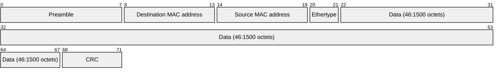
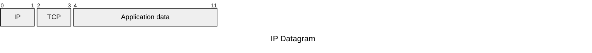

---
date:
  - 2026/10/15
  - 2026/10/20
---
<!-- We skip MOST -->

Created in 1973, CSMA/CD Ethernet had a speed of 3 Mbit/s, with a max of 256 nodes and 1 km coax cable.
In 1980 it was modified to become IEEE standard 802.3

Ethernet's goal, from the very beginning, has been to standardize the concept of Local Area Network and its key points:
- Independency
	- No master/slave approach
- Unlicensed / open domain
	- No space limitation, no rules
- Single channel
	- Shared single channel for all devices
- High bit-rate
	- No TDMA, get the access and use it at full speed

Ethernet has multiple physical standards:
- Coaxial cable (3 Mbps)
- Twisted pair (100 Mbps)
- Fiber optic (400 Gbps)

The key concept of Ethernet success is its CSMA/CD mechanism:
- CS (Carrier Sensing)
	- If the bus is busy, do not transmit
- MA (Multiple Access)
	- Once the communication starts, collisions may happen
- CD (Collision Detection)
	- Listen while speaking, if a collision is detected send a jamming sequence

When detecting a collision, Ethernet's CSMA/CD mechanism tosses a coin and waits before retrying

In the past Ethernet was used and proposed as a bus (line topology), but nowadays each LAN is configured with a Switch / Router (star topology) and full duplex cables, so nowadays there is no reason for CSMA/CD, as the collision problem has been delocalized into the switches logic

## Bit coding

First 10 Mbps versions of Ethernet used Manchester coding, which is NRZI (Non Return to Zero Inverted).

>[!INFO] NRZI
>NRZI uses high and low voltage levels to encode the bits. The absolute values are not considered. The presence or absence of transitions determine the bit values. No transition means silence, which is mapped to 0, while a transition (either from high to low or vice versa) is mapped to 1

![[Pasted image 20261020092451.png]]

100 Mbps Ethernet started using 4B5B coding

>[!INFO] 4B5B
>4B5B maps 4 bit words in 5 bits groups on the medium (NRZ)

| Data (4B) | Codeword (5B) |
| --------- | ------------- |
| 0000      | 11110         |
| 0001      | 01001         |
| 0010      | 10100         |
| 0011      | 10101         |
| 0100      | 01010         |
| 0101      | 01011         |
| 0110      | 01110         |
| 0111      | 01111         |
| 1000      | 10010         |
| 1001      | 10011         |
| 1010      | 10110         |
| 1011      | 10111         |
| 1100      | 11010         |
| 1101      | 11011         |
| 1110      | 11100         |
| 1111      | 11101         |

This is done in order to prevent 3 consecutive 0s (since 0 is more dangerous than 1), so we obtain a 25% of overhead, compared to the 100% of Manchester (EMI overhead).

## Frame structure

Due to the IEEE 803 standard there are many Ethernet variants.
We focus on the more standard one, that encapsulate Fast Ethernet (100 Mbps)

- Preamble: 8 bytes of `10101010...` used for synchronization of the receivers
- Destination MAC address: hardware address of the destination network adapter
- Source MAC address: hardware address of the source network adapter
- Ethertype: used for indicating the type of data carried by the frame or the data length
- Data: the data to be trasmitted
- CRC: 4 bytes of checksum that computes the entire frame

The typical use of an ethernet frame is to carry TCP/IP data

The CRC computation is standardized CRC-32, with the following generator:
$$
x^{32} + x^{26} + x^{23} + x^{22} + x^{16} + x^{12} + x^{11} + x^ {10} + x^8 + x^7 + x^5 + x^4 + x^2 + x + 1
$$

An Ethernet frame must be at least 64 bytes for collision detection to work. These 64 Bytes do not include preamble bytes that are not logically part of the frame. (sometimes the preamble block is even missing in the description)

## In-Car-Ethernet

We started using Ethernet in cars just in the last years, even if Ethernet is a 45 years old protocol.
This is because of various previous limitations:
- Ethernet did not meet the EMI/RFI requirements for the automotive market. 100 Mbps (and above) Ethernet have too much RF noise
- Ethernet could not guarantee latency down to the low microsecond range, which was required to replace communication to any sensor and actuator that needed fast reaction time.
- Ethernet did not have a way to control bandwidth allocation to different streams, so it could not be used to transmit shared data from multiple types of sources.
- Ethernet did not have a way of synchronizing time between devices and having multiple devices sample data at the same time

Nowadays we started using Ethernet also in cars in order to have bandwidths high enough to achieve autonomous driving

## OPEN Alliance

OPEN (One-Pair Ether-Net) Alliance is a consortium with both automotive constructors and electronics constructors, with the objective of solving the previously cited standard Ethernet's problems so that Ethernet can now be used in automotive.

A possible alternative to Ethernet could have ben MOST (which we skipped), since it was fast, but it had major drawbacks:

| MOST                                | OPEN                                      |
| ----------------------------------- | ----------------------------------------- |
| Proprietary                         | Open (except for level 1 only)            |
| Expensive                           | Cheap                                     |
| Ring topology                       | Hierarchical network                      |
| One 100 Mbps takes entirely the bus | Many 100 Mbps flows can share the network |
| Hard to extend                      | Modular                                   |
