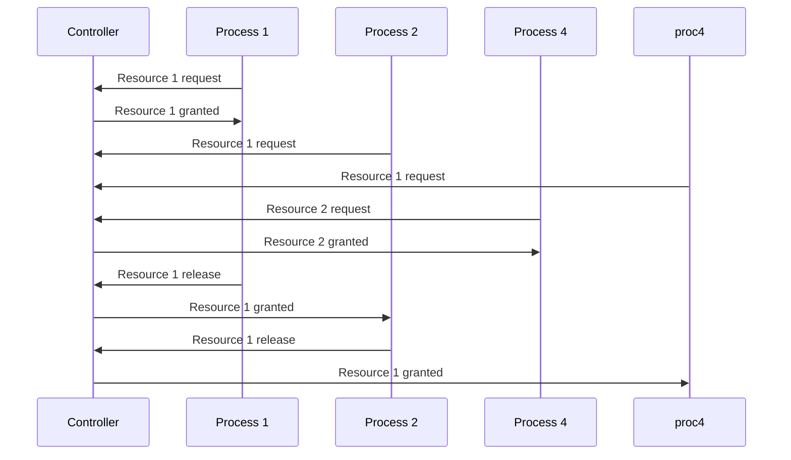
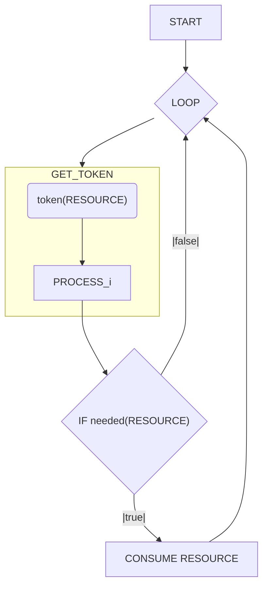

---
date:
  - 2026/10/13
---
In a simple formulation mutual exclusion is a condition in which only one process must be able to access a given resource or perform a function at any time.
A process that is accessing a mutually exclusive resource is said to be in a critical section.
An example, in a centralized IT system, is the usage of a semaphore.
In distributed systems there is need of coordination among processes and agents.

There are different algorithm which enable the distributed mutual exclusion:
- Centralized algorithm
- Distributed algorithms
	- Lamport
	- Ricart & Agrawala
- Decentralized algorithm

Mutual exclusion algorithms have different requirements:
- Safety
- Liveness
- Fairness
- Efficiency (low complexity)
- Robustness

## Centralized Algorithm

A centralized algorithm for mutual exclusion mimics a single processor system, where one process is elected as a coordinator and all other processes need to ask it for resources.
If a process asks for a resource which has already been granted to another process the coordinator doesn't reply until the resource release.
The coordinator maintains a queue of all resources, managing the requests with a FIFO approach.

Pros:
- Safe & live: only one can access and everyone will eventually access
- Fair: all requests processed in order
- Suitable for centralized resource
- Processes don't need to know each other
- Low complexity: 3 messages for each request (request, grant, release)
Cons:
- Not robust
	- Processes cannot distinguish a dead coordinator from waiting because the resource is already being used
	- Coordinator can be a bottleneck and a single point of failure
	- Not suitable for distributed resources
	- Needs leader election for the coordinator

## Distributed algorithms
### Token ring algorithm

Pros:
- Safe: mutual exclusion guaranteed
- Live: starvation cannot occur
Cons:
- Low efficiency: the token must always be transmitted (even if a process does not need the resource)
- Unfair: does not guarantee FIFO order
- Not robust: if token is lost (e.g. process died) it will have to be regenerated, and the regeneration needs a leader election to decide who regenerates it

### Lamport's Mutual Exclusion

Each process maintains a request queue, containing mutual exclusion requests.
To do so, each process has a logical scalar clock ([[Lamport's logical clock]]). Whenever a process $P_{i}$ wants to access a resource, it sends a request to all other processes, sending them its internal clock value, creating a queue which determines which process gets the resource (the one with the lower clock).

![[Pasted image 20261013152329.png]]

Pros:
- Safe: only one process at a time can access a resource
- Live: everyone will access the critical section
- Fair: requests are ordered by timestamp
Cons:
- Low efficiency & high complexity: it needs $3 \cdot (N-1)$ messages to execute the algorithm
- Not robust: if a process dies, the algorithm blocks ($N$ points of failure)

### Ricart & Agrawala algorithm

This algorithm uses a multicast and logical clocks to simplify Lamport algorithm, combining REPLY and RELEASE.

![[Pasted image 20261013153347.png]]

Pros:
- Same as Lamport algorithm
- More efficient than Lamport
Cons:
- Not robust: $N$ points of failure as with Lampert
- Low efficiency: while better than Lamport, it still needs $2 \cdot (N - 1)$ messages

| Algorithm   | Messages per entry / exit | Delay before entry | Problems                  |
| ----------- | ------------------------- | ------------------ | ------------------------- |
| Centralized | 3                         | 2                  | Coordinator crash         |
| Distributed | $2 \cdot (N - 1)$         | $2\cdot(N-1)$      | Crash of any process      |
| Token ring  | 1 to $\infty$             | 0 to $n-1$         | Lost token, process crash |

## Decentralized algorithm

The decentralized approach works by associating resources to controllers as in the centralized approach, but in this case the controllers are replicated, so that the failure of a single machine does not ruin the algorithm.
In this approach resources can be replicated as well, and each replica can be associated to one replica of the controllers, so that we obtain more efficiency in accessing the resource.

This approach works based on Distributed Hash Tables ([[DHT]]), which map replicated controllers and resources into different nodes.

Each replica has a coordinator that controls access to it (the node that stores it), and a process that wants to access any replica of a resource asks the permission to all coordinators, so the process knows that it can access the resource as soon as it receives permission from $m > \frac{n}{2}$ coordinators.
This system guarantees exclusive access (provided that a coordinator only grants access to one process at a time).

The coordinator notifies the requester both when the resource is granted and when the resource is denied, and it's requester's responsibility to count the votes and decide whether or not the overall permission has been granted or denied.
If a requester gets fewer than $m$ votes it will wait for a random time and then ask again.

Pros:
- Live enough: while some process could fall in starvation due to the random time for re-trying, it overall performs well from a probabilistic point of view
- Fair enough: because of the random time of wait for re-trying, the protocol does not ensure complete fairness, but overall it performs well from a probabilistic point of view
- Robust: if one coordinator goes down, the others are available
- Safe: if a coordinator fails and resets, then it will not remember granting access to a requester, and may then give access to another; still, because of the need of $m$ "granting" votes, it's very unlikely that this will lead to a violation of mutual exclusion
Cons:
- Not completely live: there is possibility of starvation
- Not completely fair: there is no guarantee of complete fairness
- Not so efficient: if a resource is in high demand, the protocol generates a high number of multiple requests
