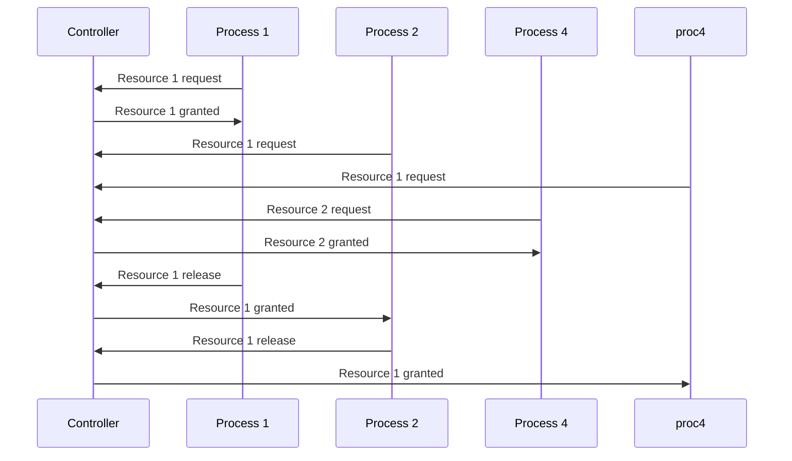
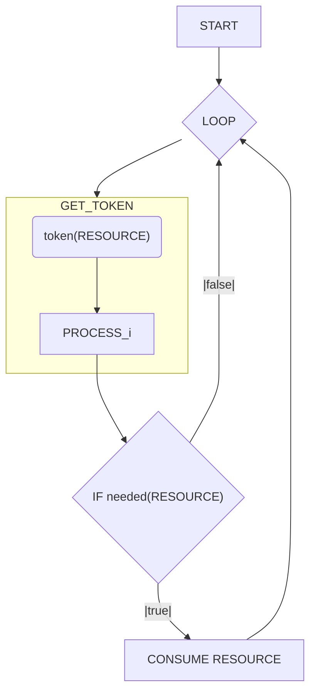

---
date:
  - 2026/10/13
---
In a simple formulation mutual exclusion is a condition in which only one process must be able to access a given resource or perform a function at any time.
A process that is accessing a mutually exclusive resource is said to be in a critical section.
An example, in a centralized IT system, is the usage of a semaphore.
In distributed systems there is need of coordination among processes and agents.

There are different algorithm which enable the distributed mutual exclusion:
- Centralized algorithm
- Distributed algorithms
	- Lamport
	- Ricart & Agrawala
- Decentralized algorithm

Mutual exclusion algorithms have different requirements:
- Safety
- Liveness
- Fairness
- Efficiency (low complexity)
- Robustness

## Centralized Algorithm

A centralized algorithm for mutual exclusion mimics a single processor system, where one process is elected as a coordinator and all other processes need to ask it for resources.
If a process asks for a resource which has already been granted to another process the coordinator doesn't reply until the resource release.
The coordinator maintains a queue of all resources, managing the requests with a FIFO approach.

Pros:
- Safe & live: only one can access and everyone will eventually access
- Fair: all requests processed in order
- Suitable for centralized resource
- Processes don't need to know each other
- Low complexity: 3 messages for each request (request, grant, release)
Cons:
- Not robust
	- Processes cannot distinguish a dead coordinator from waiting because the resource is already being used
	- Coordinator can be a bottleneck and a single point of failure
	- Not suitable for distributed resources
	- Needs leader election for the coordinator

## Distributed algorithms
### Token ring algorithm

Pros:
- Safe: mutual exclusion guaranteed
- Live: starvation cannot occur
Cons:
- Low efficiency: the token must always be transmitted (even if a process does not need the resource)
- Unfair: does not guarantee FIFO order
- Not robust: if token is lost (e.g. process died) it will have to be regenerated, and the regeneration needs a leader election to decide who regenerates it

### Lamport's Mutual Exclusion

Each process maintains a request queue, containing mutual exclusion requests.
To do so, each process has a logical scalar clock ([[Lamport's logical clock]]). Whenever a process $P_{i}$ wants to access a resource, it sends a request to all other processes, sending them its internal clock value, creating a queue which determines which process gets the resource (the one with the lower clock).

![[Pasted image 20261013152329.png]]

