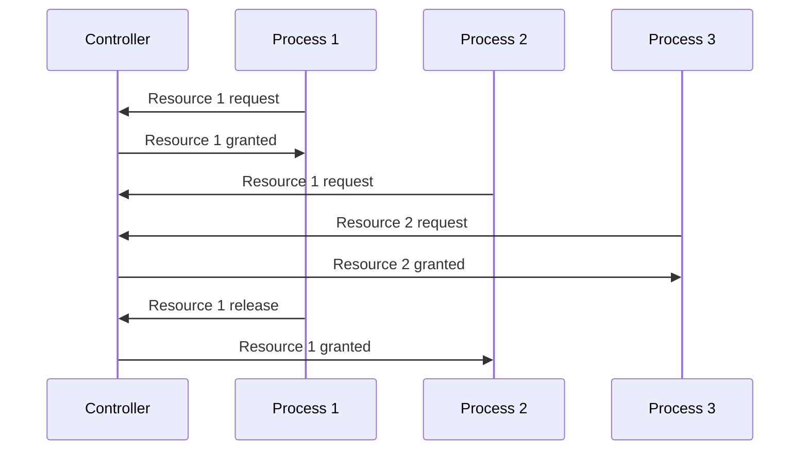

---
date:
  - 2026/10/13
---
In a simple formulation mutual exclusion is a condition in which only one process must be able to access a given resource or perform a function at any time.
A process that is accessing a mutually exclusive resource is said to be in a critical section.
An example, in a centralized IT system, is the usage of a semaphore.
In distributed systems there is need of coordination among processes and agents.

There are different algorithm which enable the distributed mutual exclusion:
- Centralized algorithm
- Distributed algorithms
	- Lamport
	- Ricart & Agrawala
- Decentralized algorithm

Mutual exclusion algorithms have different requirements:
- Safety
- Liveness
- Fairness
- Efficiency (low complexity)
- Robustness

## Centralized Algorithm

A centralized algorithm for mutual exclusion mimics a single processor system, where one process is elected as a coordinator and all other processes need to ask it for resources.
If a process asks for a resource which has already been granted to another process the coordinator doesn't reply until the resource release.
The coordinator maintains a queue of all resources, managing the requests with a FIFO approach.

