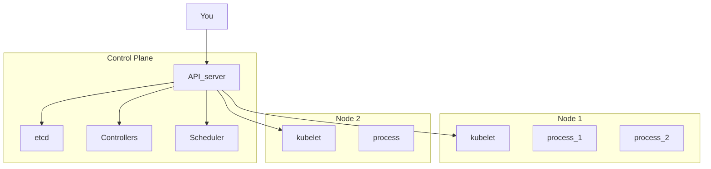

---
date:
  - 2026/10/12
---
Dal codice al cloud - Architetture, container e Kubernetes nel mondo reale

%% Selvatic Studio %%

Un'applicazione non è solo ciò che vede l'utente finale, bensì è composta da diverse parti problematiche
- Safe deployment
- Observability
- Cost attribution
- Failure management
- Regulations compliance

CI/CD: approccio nato dalla metodologia DevOps.
- CI (Continuous Integration): Per ogni merge si fa il build e il test
- CD (Continuous Deployment): Rilascio automatico
- Continuous Delivery: Il rilascio è sempre pronto ma non automatico

| VM                                                                                              | Container                                                                                              |
| ----------------------------------------------------------------------------------------------- | ------------------------------------------------------------------------------------------------------ |
| Hypervisor gira sul SO di base e tiene tutto il kernel e il SO "ospite" in un pacchetto (la VM) | Un runtime si appoggia ad un SO host e ne condivide il kernel con dei box pacchettizzati (i container) |

## Kubernetes

Kubernetes funziona tramite un approccio What You Manifest Is What You Get basato sull'utilizzo di file manifest dichiarativi.
Per poter funzionare usa un reconciliation loop, che osserva i file di manifest e lo stato attuale del cluster, ne determina le differenze, e agisce di conseguenza per muoversi verso lo stato desiderato.

